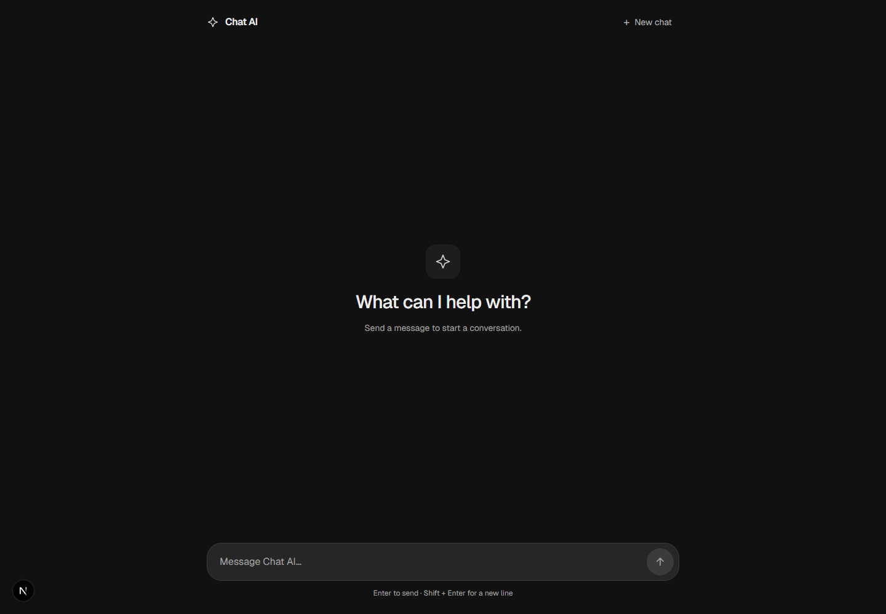
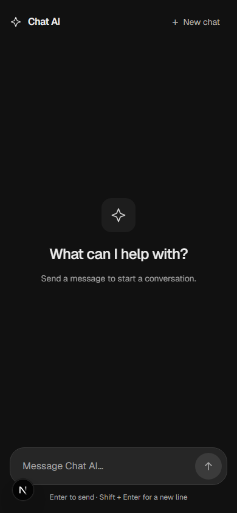
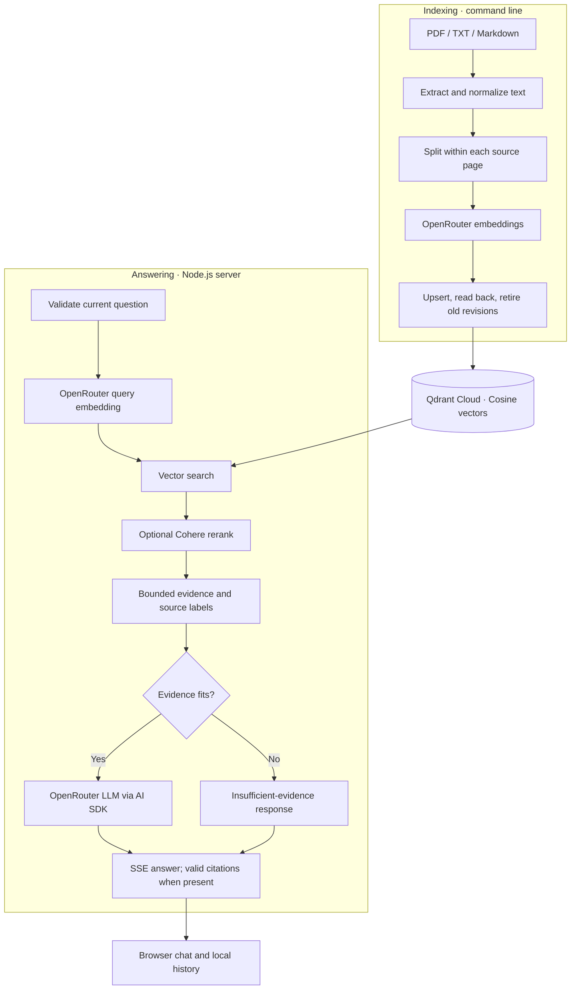

<div align="center">

<sub>DOCUMENT SEARCH · GROUNDED ANSWERS · TRACEABLE SOURCES</sub>

# Next.js AI Chat

**Ask your documents. Follow the evidence.**

A retrieval-augmented chat application built with Next.js.<br />
Index PDF, text, and Markdown files, retrieve relevant passages from Qdrant Cloud,<br />
and stream answers with citations back to the original documents.

<p>
  <a href="https://nextjs.org"></a>
  <a href="https://react.dev"></a>
  <a href="https://www.typescriptlang.org"></a>
  <a href="https://tailwindcss.com"></a>
  <a href="https://nodejs.org"></a>
</p>

[Quick start](#quick-start) · [Demo](#demo) · [Architecture](#rag-architecture) · [Configuration](docs/configuration.md) · [API reference](docs/api.md)

</div>

---

## Overview

This repository connects a browser chat interface to a document retrieval pipeline. Documents are indexed from the command line; the server embeds each new question, searches the existing collection, optionally reranks the results, and supplies bounded evidence to an OpenRouter model. Completed answers retain their source references across page reloads.

The included **TaskFlow** document set provides product, billing, API, troubleshooting, and release-note examples for trying the pipeline.

> [!NOTE]
> The current implementation uses **Qdrant Cloud** and **OpenRouter**. Cohere reranking is optional. Conversations are saved in the browser; account authentication, browser uploads, and cross-device history are not implemented.

<details>
<summary><strong>Explore this README</strong></summary>

- [Technology stack](#technology-stack)
- [Features](#features)
- [Demo](#demo)
- [RAG architecture](#rag-architecture)
- [How it works](#how-it-works)
- [Quick start](#quick-start)
- [Environment configuration](#environment-configuration)
- [Project structure](#project-structure)
- [Document ingestion](#document-ingestion)
- [Retrieval and answer generation](#retrieval-and-answer-generation)
- [Citations and source references](#citations-and-source-references)
- [Testing](#testing)
- [Troubleshooting](#troubleshooting)
- [Documentation](#documentation)
- [Contributing](#contributing)

</details>

## Technology stack

| Layer | Technology | Role |
| :--- | :--- | :--- |
| Application | [Next.js](https://nextjs.org) **16.4.2**, [React](https://react.dev) **19.3.0** | App Router, server routes, and the chat interface |
| Language and styling | [TypeScript](https://www.typescriptlang.org) **5**, [Tailwind CSS](https://tailwindcss.com) **4** | Strict types and responsive styling |
| Runtime | [Node.js](https://nodejs.org) **24** | Document ingestion and native TypeScript tests |
| Document processing | [pdf-parse](https://github.com/mehmet-kozan/pdf-parse) **2**, [LangChain text splitters](https://github.com/langchain-ai/langchainjs) **1** | Physical-page extraction and recursive text chunking |
| Vector database · required | [Qdrant Cloud](https://cloud.qdrant.io) | Persistent Cosine vector search via the REST SDK |
| Model service · required | [OpenRouter](https://openrouter.ai) | Document/query embeddings and configurable answer model |
| Answer streaming | [Vercel AI SDK](https://ai-sdk.dev) **7**, `@ai-sdk/openai` **4** | OpenAI-compatible Chat Completions adapter pointed at OpenRouter |
| Reranking · optional | [Cohere Rerank](https://docs.cohere.com/reference/rerank) | Question-aware passage ordering when explicitly enabled |
| Request validation | [Zod](https://zod.dev) **4** | Validated question and conversation metadata |

Both embedding and answer model IDs are configurable on the server. The default embedding model is Liquid's `liquid/lfm-2.5-embedding-350m:free` through OpenRouter; a separate OpenAI API key is not used. See the [configuration reference](docs/configuration.md) for defaults and limits.

## Features

| Capability | What is implemented |
| :--- | :--- |
| **Document-grounded answers** | Semantic retrieval followed by an evidence-only prompt; empty context produces an explicit insufficient-evidence response without an LLM call. |
| **PDF, text, and Markdown ingestion** | Recursive local indexing with normalization, page-preserving chunks, embeddings, and verified database writes. |
| **Semantic search** | Configurable result count and Cosine threshold, plus metadata allowlists available to trusted server code. |
| **Optional reranking** | Cohere scores reorder and select passages; unavailable reranking preserves all original vector hits. |
| **Streamed responses** | Incremental answer text, loading/error states, request deadlines, and cancellation when a chat is reset or unmounted. |
| **Saved conversations** | A chronological transcript in `localStorage`, reload recovery, duplicate-send protection, and coordination between browser tabs. |
| **Verified source identity** | Response-local citation labels resolve only against passages actually included in the prompt. |
| **Original PDF links** | Available, explicitly allowlisted sample PDFs open in a new tab at the cited page when the viewer supports it. |

Saved turns remain visible, but the current RAG handler embeds and answers **only the current question**. It does not pass earlier turns to the answer model. Ask self-contained questions rather than relying on conversational follow-up resolution.

## Demo

<p align="center">
  
  <br />
  <sub>Real application capture · desktop empty state · no generated answer shown</sub>
</p>

<details>
<summary>View the mobile interface</summary>

<p align="center">
  
</p>

</details>

After [setup](#quick-start), try these questions against the included documents:

- “What is the TaskFlow API rate limit? Cite the source.”
- “Does the Starter plan support CSV export?”
- “Can I get a refund on my first annual subscription after 10 days?”

Watch the answer stream, inspect its **Sources** list, and open an available PDF citation. Reload to confirm that the completed answer and its citations are restored. These are suggested prompts, not recorded answer results. [More sample questions](tests/fixtures/rag/taskflow-questions.json) · [Screenshot provenance](docs/assets/README.md)

## RAG architecture

**Index once, query the stored collection.** Ingestion runs locally; retrieval and answer generation run on the Node.js server.



The diagram follows the [ingestion script](scripts/ingest.ts) and [chat handler](src/app/api/chat/route.ts). The [architecture guide](docs/architecture.md) explains stage contracts, retries, context budgets, and failure behavior.

## How it works

1. **Prepare evidence.** Extract text, preserve physical PDF page numbers, normalize whitespace, and split each page into overlapping passages.
2. **Build the index.** Embed full passages through OpenRouter and store vectors with source metadata in Qdrant Cloud. Verify writes before removing older revisions of that source.
3. **Retrieve.** Embed the current question with the same model and dimensions, then query the existing collection. Optionally rerank passages with Cohere.
4. **Construct context.** Fit complete passages into a conservative input budget and assign labels such as `[S1]`. Documents are treated as untrusted data.
5. **Answer and cite.** Stream the model's text, resolve its citation markers against the actual prompt map, and save a completed turn in the browser.

## Quick start

### 1. Prerequisites

- **Node.js 24** and npm, for the repository's ingestion command and native TypeScript tests.
- An **OpenRouter API key** with access to the configured embedding and answer models.
- A **Qdrant Cloud cluster**, its HTTPS endpoint, and a write-capable API key for ingestion. The script creates a compatible collection if it is missing.

The client validates `.cloud.qdrant.io` endpoints. A local Docker database is not a supported replacement in the current code. Model availability and provider quotas depend on your account.

### 2. Clone and install

```bash
git clone https://github.com/andreworkweb/nextjs-ai-chat.git
cd nextjs-ai-chat
npm ci
```

### 3. Configure the server

Copy the safe template **only if you do not already have `.env.local`**:

```bash
cp .env.example .env.local
```

<details>
<summary>PowerShell equivalent</summary>

```powershell
if (-not (Test-Path .env.local)) { Copy-Item .env.example .env.local }
```

</details>

Edit `.env.local` and fill the required values:

```dotenv
OPENROUTER_API_KEY=your-openrouter-api-key
QDRANT_URL=https://your-cluster.your-region.cloud.qdrant.io:6333
QDRANT_API_KEY=your-qdrant-cluster-api-key
QDRANT_COLLECTION=rag_documents
```

Leave optional settings at their defaults for the first run. Existing private values should be preserved when updating configuration.

> [!IMPORTANT]
> Keep credentials in `.env.local` or private deployment settings. Never commit them, prefix them with `NEXT_PUBLIC_`, or import provider/storage modules into Client Components. Ingestion sends document text to OpenRouter and stores passages in Qdrant Cloud; enabled reranking also sends retrieved passages to Cohere.

### 4. Index the documents

Seven sample files are already included under `data/documents/`: five TaskFlow PDFs and two text examples. Add your own supported files there before indexing if needed.

```bash
npm run ingest
```

The script loads `.env.local`, prints JSON progress, and exits with a nonzero code if any file fails. Review the final summary before starting a chat. [Ingestion details](docs/ingestion.md)

### 5. Start the application

```bash
npm run dev
```

Open [localhost:3000](http://localhost:3000), ask a sample question, and inspect the completed answer's sources. Use **Enter** to send, **Shift + Enter** for a new line, and **New chat** to clear the saved conversation.

## Environment configuration

| Setting | Default / requirement |
| :--- | :--- |
| `OPENROUTER_API_KEY` | Required for embeddings and answers |
| `QDRANT_URL`, `QDRANT_API_KEY`, `QDRANT_COLLECTION` | Required; the template suggests `rag_documents` |
| `RAG_EMBEDDING_MODEL` | `liquid/lfm-2.5-embedding-350m:free` |
| `RAG_EMBEDDING_DIMENSIONS` | `1024`; must match the model and collection |
| `LLM_MODEL` | `nvidia/nemotron-3-ultra-550b-a55b:free` |
| `RAG_SEARCH_LIMIT` | `10` passages |
| `RAG_CONTEXT_TOKEN_BUDGET` | `8192` conservative input units |
| `RAG_RERANK_ENABLED` | `false`; enabling requires `COHERE_API_KEY` |

The [complete configuration reference](docs/configuration.md) covers chunk size, overlap, batching, retries, timeouts, similarity thresholds, reranking, and model changes. Defaults describe the code; they do not guarantee continued model availability.

## Project structure

```text
app/
  api/chat/route.ts              # Active Next.js route; forwards to src handler
  api/documents/[documentId]/    # GET / HEAD for allowlisted original PDFs
  lib/chat-context/              # Conversation state, storage, citations, PDF checks
  lib/read-chat-stream.ts        # SSE reader
  shared/chat.tsx                # Chat presentation
  page.tsx                      # Home page
src/
  app/api/chat/route.ts          # RAG request orchestration
  lib/rag/                      # Extraction through answer generation
scripts/ingest.ts                # Recursive indexing command
data/documents/                  # Source documents for ingestion
public/documents/taskflow/       # Already-public sample PDF copies
tests/                          # Mocked tests, opt-in live checks, and fixtures
docs/                           # Architecture and operational guides
  assets/                       # Real interface screenshots
```

Next.js discovers the root `app/` directory. `src/app/` contains the implementation re-exported by the active chat route; it is not a second application. `app/lib/RAG/extract-text.ts` is an empty legacy file; the extractor used by ingestion is in `src/lib/rag/`.

## Document ingestion

Run `npm run ingest` after adding or editing PDF, UTF-8 TXT, `.md`, or `.markdown` files under `data/documents/`. Source paths are relative to that directory. PDF chunks stay within a physical page; text files use logical page 1.

- Repeated ingestion uses deterministic IDs and replaces obsolete revisions after successful verification.
- Unsupported files are skipped. Scanned PDFs need external OCR; no OCR step is implemented.
- Run **one ingestion writer at a time**. Multi-request source updates are not transactions.
- Deleted or renamed files are **not automatically removed** from the collection.
- Changing the embedding model requires a consistent reindex; changing chunk boundaries requires re-ingestion.

[Read the ingestion and storage guide →](docs/ingestion.md)

## Retrieval and answer generation

`POST /api/chat` accepts a JSON `question` and returns Server-Sent Events. Search defaults to ten hits; successful optional reranking keeps five. The prompt builder includes only whole passages that fit its budget. Generation uses the AI SDK's OpenAI-compatible adapter with a fixed OpenRouter endpoint.

An empty search or context emits a deterministic insufficient-evidence answer. Retrieval failures return a safe error; unavailable optional reranking falls back to vector order. A nonempty result does not guarantee that the evidence answers the question, and model grounding remains subject to model behavior.

[Pipeline contracts →](docs/architecture.md) · [Request, stream, headers, and errors →](docs/api.md)

## Citations and source references

Labels such as `[S1]` refer to the exact passages included in that answer's prompt. At successful stream completion, the server emits metadata for cited, valid labels only. The UI attaches each source list to its answer and preserves it on reload.

Original PDF links become available only after a background `HEAD` check succeeds. The serving route validates an explicit public allowlist, file containment, PDF bytes, and content hash. Adding a document to the vector index does not enable PDF downloads.

> [!NOTE]
> Citation verification establishes **source identity**, not the factual correctness of the answer. The five sample PDFs are public. The application does not implement account-based document permissions or restricted retrieval.

[Citation lifecycle and document access →](docs/api.md#citations-and-original-pdfs)

## Testing

Run from the project root with Node.js 24:

```bash
npm run lint
npx --no-install tsc --noEmit
node --test tests/*.test.mjs
```

The default suite uses fake credentials, mock HTTP, and an in-memory Qdrant double. Live provider/cloud tests are skipped unless explicitly enabled. There is no `npm test` script.

For a production build, run `npm run build`, then `npm start`. The [deployment guide](docs/deployment.md) also preserves the previously documented Windows/Webpack fallback.

[Testing guide and opt-in live checks →](docs/testing.md)

## Troubleshooting

| Symptom | First check |
| :--- | :--- |
| Ingestion cannot connect | Use the cluster's HTTPS `.cloud.qdrant.io` URL and a write-capable key. |
| Collection mismatch | Model dimensions and unnamed Cosine collection settings must agree. Use a separate collection for a new vector space. |
| Embedding request rejected | Verify model access and input token limits; chunk sizes count characters, not tokens. |
| `503 RAG_UNAVAILABLE` | Check embedding configuration, cloud access, and whether ingestion completed. |
| Insufficient-evidence answer | Inspect the collection, score threshold, and context budget. |
| Sources remain plain text | Only the allowlisted PDFs can open; their original bytes and hashes must match. |
| History is not restored | Allow browser storage; use **New chat** to reset invalid saved history. |

[Detailed troubleshooting and deployment checks →](docs/deployment.md#troubleshooting)

## Documentation

| Guide | Contents |
| :--- | :--- |
| [Architecture](docs/architecture.md) | Indexing/query stages, helper contracts, trust boundaries, and failure handling |
| [Configuration](docs/configuration.md) | Every environment setting, default, accepted range, and model migration notes |
| [Ingestion](docs/ingestion.md) | Formats, normalization, identifiers, storage verification, and revision cleanup |
| [API and citations](docs/api.md) | Request validation, SSE protocol, diagnostics, errors, and original PDFs |
| [Testing](docs/testing.md) | Offline checks, focused test commands, live flags, and manual verification |
| [Deployment](docs/deployment.md) | Production builds, Vercel configuration, and troubleshooting |
| [Contributing](CONTRIBUTING.md) | Focused changes, engineering rules, and review checklist |

## Contributing

Start with the [contributor guide](CONTRIBUTING.md), keep changes focused, and run the checks appropriate to your change. Implementation references throughout the docs link directly to the relevant source files.

No license file is included in this repository. Review usage and redistribution permissions with the repository owner.
