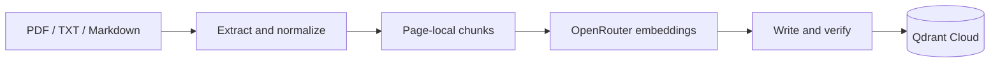
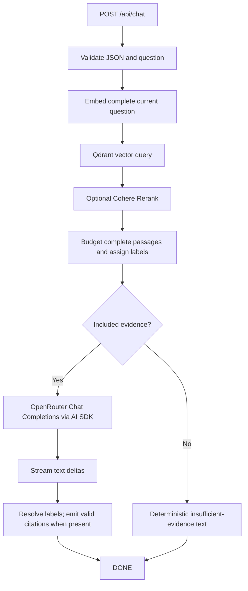

# RAG architecture

[← README](../README.md) · [Configuration](configuration.md) · [Ingestion](ingestion.md) · [API](api.md)

The application has two entry points: a local ingestion command that writes to Qdrant Cloud, and a Node.js chat route that retrieves evidence and streams answers. Provider credentials stay on the server. The browser receives answer text, verified display citations, and pipeline status headers.

## Indexing pipeline



| Stage | Implementation | Contract |
| :--- | :--- | :--- |
| Discover | [`ingestDocuments`](../scripts/ingest.ts) | Recursively scan supported regular files, using normalized relative source paths. |
| Extract and normalize | [`extractText`](../src/lib/rag/extract-text.ts), [`normalizeText`](../src/lib/rag/normalize-text.ts) | Return `ParsedPage[]`; preserve physical PDF pages and original-byte content identity. |
| Split | [`splitText`](../src/lib/rag/split-text.ts) | Return page-local `Chunk[]` with deterministic IDs and zero-based per-page indexes. |
| Embed | [`generateEmbeddings`](../src/lib/rag/generate-embeddings.ts) | Return `EmbeddedChunk[]`, adding a finite vector while preserving chunk metadata and text. |
| Store | [`storeEmbeddings`](../src/lib/rag/store-embeddings.ts), [`qdrant`](../src/lib/rag/qdrant.ts) | Ensure a compatible collection, upsert, read back, verify, and retire obsolete source revisions. |

The extractor already normalizes its output; ingestion does not normalize it a second time. See [document processing and revision behavior](ingestion.md) for the full storage lifecycle.

## Retrieval pipeline



The active [`app/api/chat/route.ts`](../app/api/chat/route.ts) re-exports [`src/app/api/chat/route.ts`](../src/app/api/chat/route.ts). Root `app/` is the Next.js application directory. The project enables `cacheComponents`; keep the route on the Node.js server and heed the installed Next.js guide before changing route configuration.

### Shared embeddings

`embedQuery(question, options?)` embeds one complete question and returns `number[]`. Both query and document embedding call the same `embedTexts` transport, use `OPENROUTER_API_KEY`, and read the same `RAG_EMBEDDING_*` settings. Neither helper silently truncates inputs or switches models. Provider token limits still apply.

The transport posts to the fixed `https://openrouter.ai/api/v1/embeddings` endpoint. Batches run sequentially. Each batch has a default budget of three retries, configurable up to five. Rate limits, timeouts, network errors, and temporary server errors use exponential delays starting at 500 ms. `Retry-After` is honored; a required wait above 30 seconds fails safely instead of retrying early. Authentication errors, permanent request failures, and invalid vectors are not retried.

HTTP, sleep, and cancellation can be injected for isolated tests. Safe `EmbeddingGenerationError` instances exclude raw provider bodies and transport exceptions. Embedding helpers do not write to the database.

### Vector search

`searchVectors(queryEmbedding, options?)` uses Qdrant's `query()` API against the existing collection. It does not create collections or write data. It requests only the needed payload fields and omits stored vectors.

The default limit is ten, with an optional Cosine threshold and descending score order. Inputs must be finite, nonzero vectors matching configured dimensions. Empty collections, unmatched filters, or thresholds can return `[]`; missing collections, malformed metadata, and database failures raise safe `QdrantStorageError` errors.

Trusted backend callers can restrict metadata:

```typescript
const vector = await embedQuery(question);
const chunks = await searchVectors(vector, {
  limit: 10,
  filter: {
    documentIds: authorizedDocumentIds,
    sourceNames: selectedSourceNames,
  },
});
```

The two exact-match allowlists combine with AND; values within a list combine with OR. Each list accepts up to 1000 nonempty strings. An empty list denies all results without a database call. Invalid fields and out-of-scope returned metadata are rejected.

These are helper capabilities, not account permissions. `/api/chat` does not accept browser-supplied filters or derive an authenticated retrieval scope. It queries the configured collection. Do not place restricted documents in a publicly accessible collection without adding server-side authorization to retrieval.

### Optional reranking

`rerankChunks(question, chunks, options?)` sends the original question and passage texts to `https://api.cohere.com/v2/rerank` when enabled. It maps returned indexes back to complete original metadata, sorts genuine relevance scores, and retains up to five passages by default. Ties retain vector-search order. The input array is not mutated.

Disabled or unavailable reranking returns **every original hit**, in its existing order, without adding scores or truncating to five. Missing keys, invalid optional settings, HTTP/authentication errors, rate limits, network failures, timeouts, and malformed/incomplete responses fall back. There is one bounded request, with no retries; the default ten-second timeout includes reading the body. Caller cancellation propagates rather than starting answer generation.

Successful `RerankedChunk` results add `rerankScore` in `[0, 1]` while retaining the original vector `score`. No questions, passages, credentials, or provider bodies are logged by this helper.

### Context construction

`buildPrompt(question, chunks, options?)` performs no network requests. Its typed `BuiltPrompt` contains two messages, a source map, a budget estimate, and included/omitted chunk counts. The system message instructs the model to use supplied evidence, cite valid labels, disclose insufficient evidence, and describe conflicts.

The JSON user message contains the complete question and explicitly untrusted evidence. Filenames and document text cannot create additional message roles. This separation reduces prompt-injection risk; it is not a guarantee of model compliance.

The default budget of 8192 includes instructions, question, JSON structure, metadata, passages, and framing. Accounting conservatively estimates one unit per UTF-8 byte plus message overhead; it is not a model-specific tokenizer. Complete passages are included in relevance order only when they fit. Oversized passages are skipped so smaller ones can still fit; question and passage text are never shortened.

Complete reranked sets use Cohere relevance; other sets use vector similarity. Ties preserve order. Mixed score types are rejected. Only included passages receive `[S1]`, `[S2]`, and subsequent response-local mappings to real document/chunk/page identities. Invalid settings produce `PromptConstructionError`; mandatory instructions and question exceeding the budget produce `BUDGET_EXCEEDED`.

### Answer generation

`generateAnswer(builtPrompt, options?)` validates the structured prompt and returns `{ stream, sources, status }`. The source map is cloned server-side. With zero included passages, it emits this deterministic response and completion marker without a model request:

> The supplied documents do not provide enough information to answer this question.

Otherwise, Vercel AI SDK 7 `streamText` uses `instructions` and `result.stream`, with `@ai-sdk/openai`'s Chat Completions adapter pointed at `https://openrouter.ai/api/v1`. This path does not use the OpenAI Responses API or AI Gateway. The output cap is 8192 tokens; automatic generation retries are disabled to avoid duplicate output.

The server waits for the first actual text before sending successful headers, allowing early failures to use HTTP status codes. Later failures become a sanitized SSE error without `[DONE]`. Only successfully completed responses commit answer citations. Reasoning, prompts, SDK/provider metadata, raw errors, and credentials are not forwarded.

The answer is prompted to stay within the evidence. Nonempty retrieval is not proof of relevance; the model can still misinterpret evidence. [Citations verify identity, not truth](api.md#citations-and-original-pdfs).

## Cancellation and deadlines

| Stage | Behavior |
| :--- | :--- |
| Entire route | Fixed 180000 ms signal combines request cancellation with the overall deadline. |
| Embeddings | Per-batch configurable timeout and bounded retries; caller cancellation stops work. |
| Qdrant | SDK network timeout is 30000 ms; cancellation stops awaiting promptly while the SDK request may settle later. |
| Cohere | Configurable timeout, graceful optional fallback; caller cancellation propagates. |
| Generation | Configurable timeout, plus the overall route deadline; cancellation aborts the model request. |
| Browser | New chat, unmount, and relevant cross-tab changes abort the active request. |

## Browser state and trust boundaries

The UI stores one anonymous browser profile's conversation in `localStorage`, validates it on restoration, and retains a full chronological transcript. A bounded suffix of completed turns is sent as metadata: at most 100 messages and 48 KiB of text. The current route validates history but does not send it to the answer model or use it for query rewriting. Conversation IDs identify browser state, not authenticated users.

Duplicate submissions are locked within a tab, with Web Locks coordination when available across tabs. Reset cancels generation. Interrupted responses never commit partial citation maps; resending the failed question can reuse its turn ID. Storage failures preserve functioning in-memory chat and show an error. See [testing](testing.md) for verification steps.
